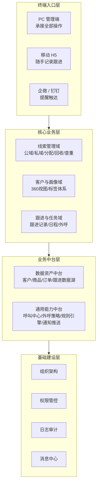
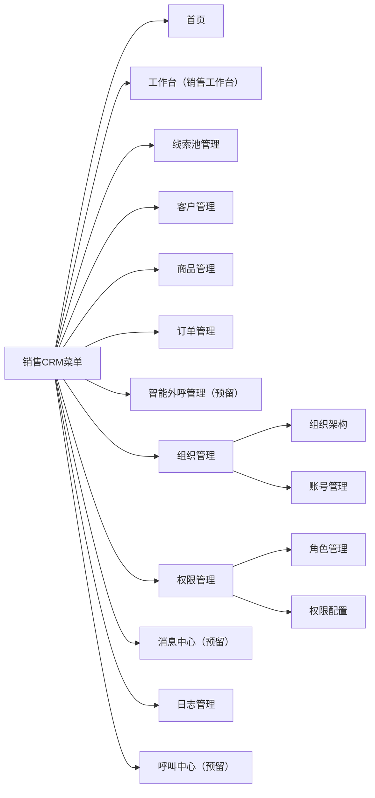
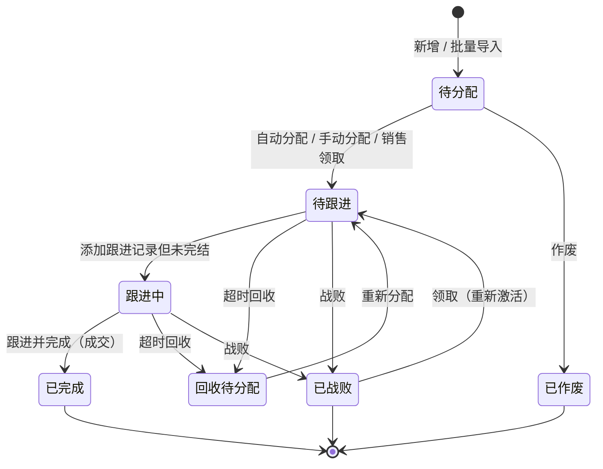
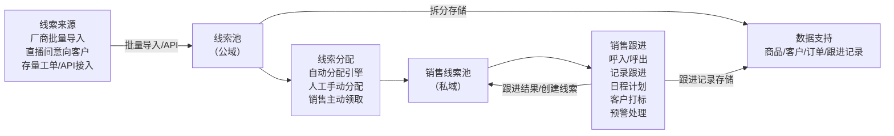
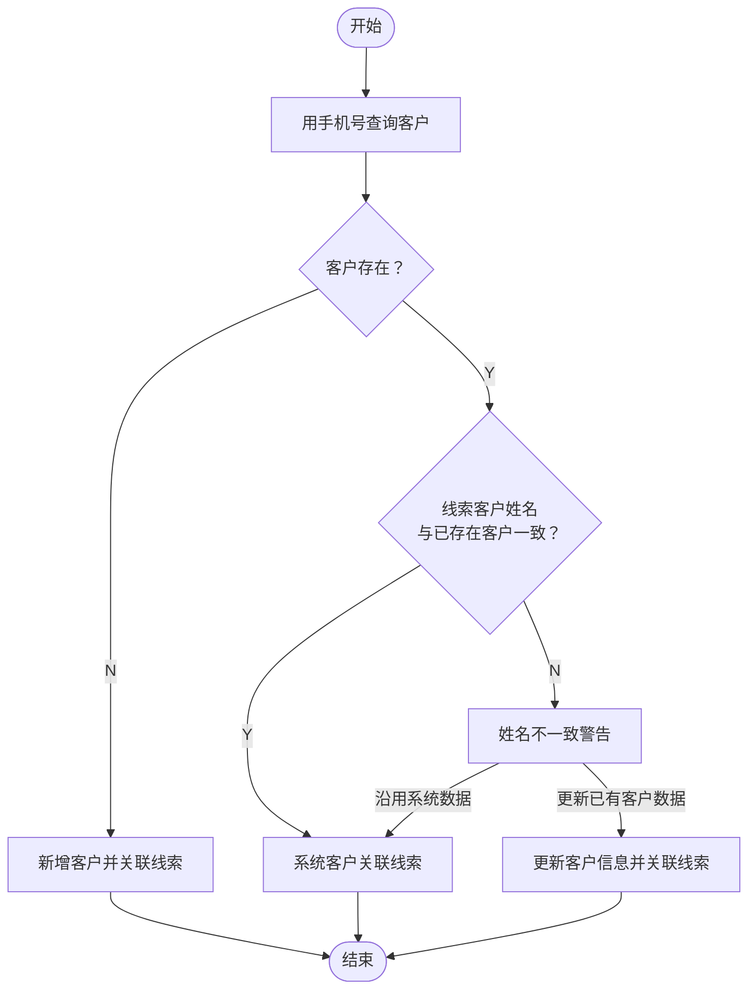
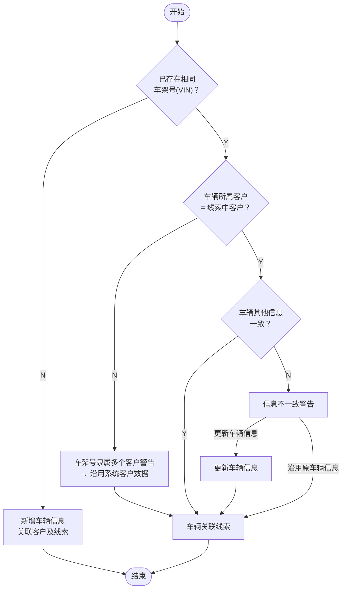
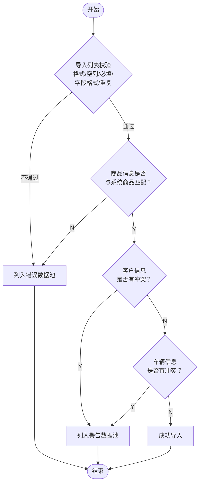
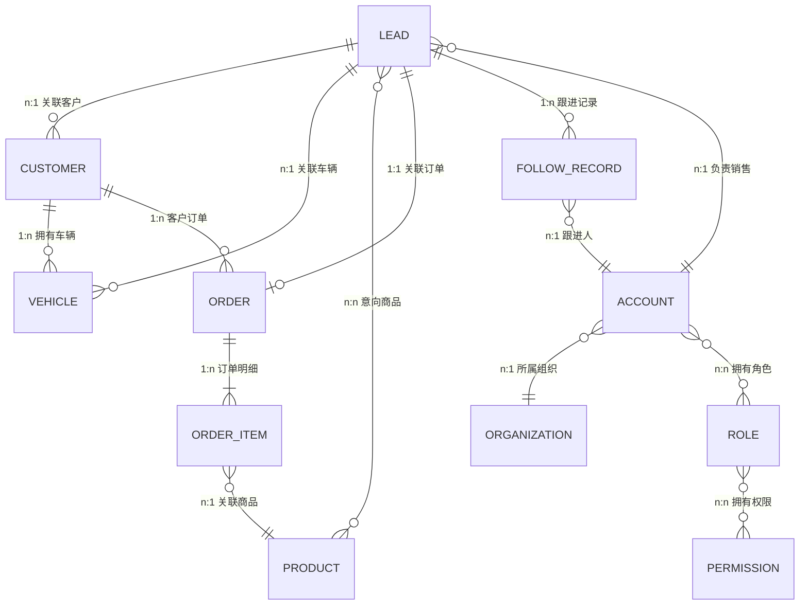
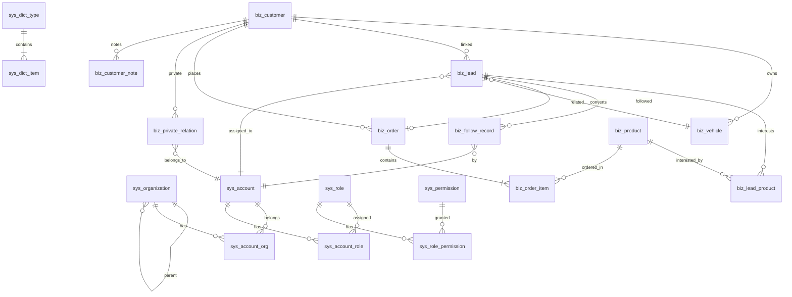

# 车和网 CRM 销售系统 — 技术实施文档

> **版本**: V1.0.0 | **基线需求文档**: 2026-07-02 - V1.0.0 -CRM-销售系统  
> **编制日期**: 2026-07-07

---

## 一、系统总览

### 1.1 系统定位

面向车和网销售团队的自主客户关系管理系统，统一管理多厂商线索、客户、跟进、成交全生命周期数据，解决线索分散、数据裸露、机制缺失、数据割裂四大痛点。

### 1.2 产品架构（四层）

### 1.3 产品分期规划

| 阶段 | 内容 | 核心模块 |
|------|------|--------|
| **第一阶段：基础建设** | PC管理端 MVP | 线索池（公域/私域，手动分配，跟进记录）、客户资源库、商品库、订单库、组织管理、权限管控、日志审计、客户360视图 |
| **第二阶段：外呼能力搭建** | 接入第三方呼叫 | 外呼账号管理、统一通讯适配器单间、呼入/呼出 |
| **第三阶段：预警与规则引擎** | 自动化运营 | 企微/钉钉通知、自动分配规则引擎、回收规则引擎、预警规则引擎、消息中心 |
| **第四阶段：数据与AI接入** | 智能化升级 | 智能外呼、数据看板、AI识别与总结 |

> [!IMPORTANT]
> **本技术实施文档聚焦第一阶段（基础建设）的全部功能**，二至四阶段在架构上做预留设计。

---

## 二、功能架构设计

### 2.1 菜单结构

### 2.2 核心业务流程

#### 2.2.1 线索全生命周期状态机

**状态与操作权限映射：**

| 线索状态 | 可执行操作 |
|---------|---------|
| 待分配 | 编辑、分配、领取、作废 |
| 回收待分配 | 编辑、分配、领取、作废 |
| 待跟进 | 详情 |
| 跟进中 | 详情 |
| 已完成 | 详情 |
| 已战败 | 详情、领取 |
| 已作废 | 详情 |

#### 2.2.2 线索流转主流程

#### 2.2.3 客户信息校验流程（新增/导入线索时）

> [!NOTE]
> 完整的客户校验包含 **身份证号存在** 和 **身份证号不存在** 两条主链路，每条链路下又有电话匹配、姓名比对等多级分支判断。详见需求文档中客户信息校验思维导图。

#### 2.2.4 车辆信息校验流程

#### 2.2.5 批量导入数据验证流程

导入完成后反馈：`总共操作X条，成功x条，警告待处理y条，失败n条`

---

### 2.3 各模块功能清单

#### 2.3.1 登录模块

| 功能点 | 说明 |
|-------|------|
| 登录方式 | 账号 + 密码 |
| 账号来源 | 组织管理 → 账号管理 |
| 角色路由 | 含"销售"角色 → 销售工作台；其他 → 首页 |
| 异常提示 | 账号不存在/已离职 → "账号/密码有误"；账号禁用 → "账号已禁用，请联系管理员" |
| 必填校验 | 字段为空 → "请输入XX！" |

#### 2.3.2 组织管理

**组织架构：**
- 树形结构展示，默认展开全部，支持收起/展开
- 点击组织名称 → 右侧展示详情（组织ID、父组织、名称、编码、层级、状态、时间）
- 新增：名称≤30字符，父级仅选启用组织，同父下名称不可重复
- 编辑：编码不可改，层级不可改，修改父级时校验子组织不超最大层级

**账号管理：**
- 列表字段：账号ID、账号（工号）、密码（加密）、姓名、手机号、所属组织（全路径）、状态、时间、操作
- 状态：正常 / 禁用 / 已离职
- 编码规则：`ACC_00001` 递增
- 新增：全部必填，手机号校验，账号仅英文+数字≤10位，工号和手机号唯一
- 编辑：编码和工号不可改
- 重置密码：英文+数字，6-10位，两次密码一致性校验

#### 2.3.3 线索池管理

**线索池列表：**
- 字段：序号、线索编码、客户姓名、客户电话、身份证号、渠道来源、线索来源方式、来源日期、添加微信状态、客户沟通倾向、呼叫结果、意向商品、意向赠品、创建时间、最新跟进时间、关联订单编号、操作
- 固定列：线索ID / 客户姓名 / 客户电话（左固定），关联订单 / 操作（右固定）
- 搜索条件：渠道来源、客户姓名（模糊）、客户电话（模糊）、线索状态（多选）
- 分页默认 10 条

**新增线索：**
- 含客户信息校验（手机号去重 + 身份证号去重 + 姓名比对）
- 含车辆信息校验（VIN 去重 + 所属客户比对 + 车辆详情比对）

**批量导入：**
- 支持模板下载 → 上传文件
- 三类结果分流：无误数据（正常导入）→ 错误数据（下载错误Excel）→ 警告数据（进入临时表，待确认）
- 警告处理：客户信息警告（沿用系统 / 更新系统 / 新增用户）+ 车辆信息警告

**批量分配：**
- 仅待分配/回收待分配状态可选中
- 支持勾选后批量分配给单个销售

#### 2.3.4 商品管理

| Tab | 字段 |
|-----|------|
| 实物商品 | 商品编码、商品类型（充电桩/延保/精品）、规格参数（KV对）、单位（个/套）、成本价、售价、状态（生效中/已归档） |
| 券商品 | 券名称、券类型、券码、面额、有效期天数、来源 |

#### 2.3.5 权限管理

**角色管理：**
- 列表字段：角色ID、角色名称、角色编码、状态（启用/停用）、备注说明
- 新增：名称必填，状态默认启用，说明≤100字符

**权限配置：**
- 角色 → 菜单/操作权限矩阵

#### 2.3.6 数据字典

配置项：渠道来源、线索来源方式、添加微信进度、购买意向、客户沟通倾向
通过 code 关联业务应用

---

## 三、实体关系总览

**关系表汇总：**

| 关系表 | 连接实体 | 说明 |
|--------|---------|------|
| 私域关系表 | 客户 ↔ 销售 | 客户ID、关联销售ID、首次关联时间、状态、是否含加微信、销售备注信息 |
| 线索信息关系表 | 线索 ↔ 客户/商品/订单 | 线索ID、客户ID、意向商品ID、商品ID、订单ID、创建时间、更新时间 |
| 客户订单关系表 | 客户 ↔ 订单 | 客户ID、订单ID、创建时间 |
| 客户合住表 | 客户 ↔ 客户 | 客户ID、客户合住内容、创建时间、创建人ID |

---

## 四、数据库表结构设计

> [!NOTE]
> 以下所有表设计基于 **MySQL 8.0+**，字符集 `utf8mb4`，排序规则 `utf8mb4_general_ci`。
> 所有表均包含 `created_at`、`updated_at` 时间戳字段（自动维护）。
> 主键统一使用 `BIGINT UNSIGNED AUTO_INCREMENT`，业务编码另设唯一索引。
> 敏感字段（手机号、身份证号）在应用层加密存储，数据库存密文 + 摘要索引。

### 4.1 基础建设层

#### 4.1.1 组织表 `sys_organization`

| 字段名 | 类型 | 约束 | 说明 |
|--------|------|------|------|
| `id` | BIGINT UNSIGNED | PK, AUTO_INCREMENT | 组织ID |
| `parent_id` | BIGINT UNSIGNED | FK → self, NULLABLE | 父级组织ID，顶级为 NULL |
| `org_name` | VARCHAR(60) | NOT NULL | 组织名称（≤30中文字符） |
| `org_code` | VARCHAR(32) | UNIQUE, NOT NULL | 组织编码 |
| `org_level` | TINYINT UNSIGNED | NOT NULL | 组织层级（1=顶级） |
| `org_path` | VARCHAR(512) | NOT NULL | 全路径，如 `/1/3/7/` 用于快速祖先查询 |
| `status` | TINYINT | NOT NULL, DEFAULT 1 | 1=启用, 0=禁用 |
| `sort_order` | INT | DEFAULT 0 | 同级排序 |
| `created_at` | DATETIME | NOT NULL, DEFAULT CURRENT_TIMESTAMP | 创建时间 |
| `updated_at` | DATETIME | ON UPDATE CURRENT_TIMESTAMP | 更新时间 |

**索引：**
- `idx_parent_id` (`parent_id`)
- `idx_org_path` (`org_path`)
- `uk_org_code` (`org_code`) UNIQUE

---

#### 4.1.2 账号表 `sys_account`

| 字段名 | 类型 | 约束 | 说明 |
|--------|------|------|------|
| `id` | BIGINT UNSIGNED | PK, AUTO_INCREMENT | 账号ID |
| `account_code` | VARCHAR(16) | UNIQUE, NOT NULL | 账号编码 ACC_00001 |
| `username` | VARCHAR(20) | UNIQUE, NOT NULL | 账号（工号），英文+数字≤10位 |
| `password_hash` | VARCHAR(128) | NOT NULL | 密码 bcrypt 哈希 |
| `real_name` | VARCHAR(60) | NOT NULL | 员工真实姓名 |
| `phone` | VARCHAR(64) | NOT NULL | 手机号（加密存储） |
| `phone_hash` | VARCHAR(64) | UNIQUE, NOT NULL | 手机号 SHA256 摘要，用于唯一校验 |
| `status` | TINYINT | NOT NULL, DEFAULT 1 | 1=正常, 0=禁用, 2=已离职 |
| `last_login_at` | DATETIME | NULLABLE | 最后登录时间 |
| `created_at` | DATETIME | NOT NULL, DEFAULT CURRENT_TIMESTAMP | |
| `updated_at` | DATETIME | ON UPDATE CURRENT_TIMESTAMP | |

**索引：**
- `uk_username` (`username`) UNIQUE
- `uk_phone_hash` (`phone_hash`) UNIQUE
- `idx_status` (`status`)

---

#### 4.1.3 账号-组织关系表 `sys_account_org`

| 字段名 | 类型 | 约束 | 说明 |
|--------|------|------|------|
| `id` | BIGINT UNSIGNED | PK, AUTO_INCREMENT | |
| `account_id` | BIGINT UNSIGNED | FK, NOT NULL | 账号ID |
| `org_id` | BIGINT UNSIGNED | FK, NOT NULL | 组织ID |
| `created_at` | DATETIME | DEFAULT CURRENT_TIMESTAMP | |

**索引：**
- `uk_account_org` (`account_id`, `org_id`) UNIQUE

> [!TIP]
> 一个账号可属于多个组织，因此使用中间表实现多对多关系。

---

#### 4.1.4 角色表 `sys_role`

| 字段名 | 类型 | 约束 | 说明 |
|--------|------|------|------|
| `id` | BIGINT UNSIGNED | PK, AUTO_INCREMENT | 角色ID |
| `role_name` | VARCHAR(60) | UNIQUE, NOT NULL | 角色名称 |
| `role_code` | VARCHAR(32) | UNIQUE, NOT NULL | 角色编码 |
| `status` | TINYINT | NOT NULL, DEFAULT 1 | 1=启用, 0=停用 |
| `remark` | VARCHAR(200) | NULLABLE | 角色说明（≤100中文字符） |
| `created_at` | DATETIME | DEFAULT CURRENT_TIMESTAMP | |
| `updated_at` | DATETIME | ON UPDATE CURRENT_TIMESTAMP | |

---

#### 4.1.5 账号-角色关系表 `sys_account_role`

| 字段名 | 类型 | 约束 | 说明 |
|--------|------|------|------|
| `id` | BIGINT UNSIGNED | PK, AUTO_INCREMENT | |
| `account_id` | BIGINT UNSIGNED | FK, NOT NULL | |
| `role_id` | BIGINT UNSIGNED | FK, NOT NULL | |
| `created_at` | DATETIME | DEFAULT CURRENT_TIMESTAMP | |

**索引：** `uk_account_role` (`account_id`, `role_id`) UNIQUE

---

#### 4.1.6 权限表 `sys_permission`

| 字段名 | 类型 | 约束 | 说明 |
|--------|------|------|------|
| `id` | BIGINT UNSIGNED | PK, AUTO_INCREMENT | |
| `parent_id` | BIGINT UNSIGNED | NULLABLE | 父权限ID |
| `perm_name` | VARCHAR(60) | NOT NULL | 权限名称 |
| `perm_code` | VARCHAR(64) | UNIQUE, NOT NULL | 权限编码（如 `lead:pool:edit`） |
| `perm_type` | TINYINT | NOT NULL | 1=菜单, 2=按钮/操作, 3=数据 |
| `path` | VARCHAR(256) | NULLABLE | 前端路由路径 |
| `icon` | VARCHAR(64) | NULLABLE | 菜单图标 |
| `sort_order` | INT | DEFAULT 0 | 排序 |
| `status` | TINYINT | DEFAULT 1 | 1=启用, 0=停用 |
| `created_at` | DATETIME | DEFAULT CURRENT_TIMESTAMP | |

---

#### 4.1.7 角色-权限关系表 `sys_role_permission`

| 字段名 | 类型 | 约束 | 说明 |
|--------|------|------|------|
| `id` | BIGINT UNSIGNED | PK, AUTO_INCREMENT | |
| `role_id` | BIGINT UNSIGNED | FK, NOT NULL | |
| `permission_id` | BIGINT UNSIGNED | FK, NOT NULL | |
| `created_at` | DATETIME | DEFAULT CURRENT_TIMESTAMP | |

**索引：** `uk_role_perm` (`role_id`, `permission_id`) UNIQUE

---

#### 4.1.8 数据字典类型表 `sys_dict_type`

| 字段名 | 类型 | 约束 | 说明 |
|--------|------|------|------|
| `id` | BIGINT UNSIGNED | PK, AUTO_INCREMENT | |
| `dict_type_code` | VARCHAR(64) | UNIQUE, NOT NULL | 字典类型编码（如 `channel_source`） |
| `dict_type_name` | VARCHAR(60) | NOT NULL | 字典类型名称（如"渠道来源"） |
| `status` | TINYINT | DEFAULT 1 | |
| `remark` | VARCHAR(200) | NULLABLE | |
| `created_at` | DATETIME | DEFAULT CURRENT_TIMESTAMP | |

---

#### 4.1.9 数据字典项表 `sys_dict_item`

| 字段名 | 类型 | 约束 | 说明 |
|--------|------|------|------|
| `id` | BIGINT UNSIGNED | PK, AUTO_INCREMENT | |
| `dict_type_id` | BIGINT UNSIGNED | FK, NOT NULL | 所属字典类型 |
| `item_code` | VARCHAR(64) | NOT NULL | 字典项编码 |
| `item_label` | VARCHAR(120) | NOT NULL | 显示名称 |
| `item_value` | VARCHAR(120) | NOT NULL | 存储值 |
| `sort_order` | INT | DEFAULT 0 | |
| `status` | TINYINT | DEFAULT 1 | |
| `created_at` | DATETIME | DEFAULT CURRENT_TIMESTAMP | |

**索引：** `uk_type_code` (`dict_type_id`, `item_code`) UNIQUE

**预置字典类型：**
- `channel_source` — 渠道来源（赛力斯、直播间、存量工单...）
- `lead_source_method` — 线索来源方式
- `wechat_add_status` — 添加微信进度
- `purchase_intention` — 购买意向
- `communication_tendency` — 客户沟通倾向
- `call_result` — 呼叫结果

---

#### 4.1.10 操作日志表 `sys_operation_log`

| 字段名 | 类型 | 约束 | 说明 |
|--------|------|------|------|
| `id` | BIGINT UNSIGNED | PK, AUTO_INCREMENT | |
| `account_id` | BIGINT UNSIGNED | NOT NULL | 操作人 |
| `module` | VARCHAR(32) | NOT NULL | 模块名（lead/customer/order...） |
| `action` | VARCHAR(32) | NOT NULL | 操作类型（create/update/delete/import/export） |
| `target_type` | VARCHAR(32) | NULLABLE | 操作对象类型 |
| `target_id` | BIGINT UNSIGNED | NULLABLE | 操作对象ID |
| `detail` | JSON | NULLABLE | 操作详情（变更前后 diff） |
| `ip` | VARCHAR(45) | NULLABLE | 操作IP |
| `user_agent` | VARCHAR(256) | NULLABLE | |
| `created_at` | DATETIME | DEFAULT CURRENT_TIMESTAMP | |

**索引：**
- `idx_account_id` (`account_id`)
- `idx_module_action` (`module`, `action`)
- `idx_created_at` (`created_at`)

---

### 4.2 核心业务层

#### 4.2.1 客户表 `biz_customer`

| 字段名 | 类型 | 约束 | 说明 |
|--------|------|------|------|
| `id` | BIGINT UNSIGNED | PK, AUTO_INCREMENT | 客户ID |
| `customer_name` | VARCHAR(60) | NOT NULL | 客户姓名 |
| `id_card_no` | VARCHAR(128) | NULLABLE | 身份证号（加密存储） |
| `id_card_hash` | VARCHAR(64) | NULLABLE, UNIQUE | 身份证号 SHA256 摘要 |
| `phone` | VARCHAR(128) | NOT NULL | 电话号码（加密存储） |
| `phone_hash` | VARCHAR(64) | NOT NULL, UNIQUE | 电话号码 SHA256 摘要 |
| `gender` | TINYINT | NULLABLE | 0=未知, 1=男, 2=女 |
| `birthday` | DATE | NULLABLE | 生日 |
| `customer_tags` | VARCHAR(512) | NULLABLE | 客户标签（KV对，JSON） |
| `customer_source` | VARCHAR(32) | NULLABLE | 客户来源 |
| `status` | TINYINT | DEFAULT 1 | 1=正常, 0=冻结 |
| `remark` | TEXT | NULLABLE | 备注 |
| `created_at` | DATETIME | DEFAULT CURRENT_TIMESTAMP | |
| `updated_at` | DATETIME | ON UPDATE CURRENT_TIMESTAMP | |

**索引：**
- `uk_phone_hash` (`phone_hash`) UNIQUE
- `uk_id_card_hash` (`id_card_hash`) UNIQUE（允许NULL）
- `idx_customer_name` (`customer_name`)

---

#### 4.2.2 车辆信息表 `biz_vehicle`

| 字段名 | 类型 | 约束 | 说明 |
|--------|------|------|------|
| `id` | BIGINT UNSIGNED | PK, AUTO_INCREMENT | |
| `customer_id` | BIGINT UNSIGNED | FK, NOT NULL | 所属客户ID |
| `brand` | VARCHAR(60) | NULLABLE | 品牌 |
| `plate_no` | VARCHAR(20) | NULLABLE | 车牌号 |
| `model` | VARCHAR(60) | NULLABLE | 车型款式 |
| `vin` | VARCHAR(17) | UNIQUE, NOT NULL | 车架号(VIN) |
| `purchase_date` | DATE | NULLABLE | 购车日期 |
| `mileage` | INT UNSIGNED | DEFAULT 0 | 当前公里数 |
| `vehicle_status` | TINYINT | DEFAULT 1 | 1=正常, 0=已报废 |
| `remark` | VARCHAR(512) | NULLABLE | 备注 |
| `created_at` | DATETIME | DEFAULT CURRENT_TIMESTAMP | |
| `updated_at` | DATETIME | ON UPDATE CURRENT_TIMESTAMP | |

**索引：**
- `uk_vin` (`vin`) UNIQUE
- `idx_customer_id` (`customer_id`)
- `idx_plate_no` (`plate_no`)

---

#### 4.2.3 线索表 `biz_lead`

| 字段名 | 类型 | 约束 | 说明 |
|--------|------|------|------|
| `id` | BIGINT UNSIGNED | PK, AUTO_INCREMENT | |
| `lead_code` | VARCHAR(32) | UNIQUE, NOT NULL | 线索编码 |
| `customer_id` | BIGINT UNSIGNED | FK, NULLABLE | 关联客户ID |
| `vehicle_id` | BIGINT UNSIGNED | FK, NULLABLE | 关联车辆ID |
| `channel_source` | VARCHAR(32) | NOT NULL | 渠道来源（字典code） |
| `source_method` | VARCHAR(32) | NULLABLE | 线索来源方式（字典code） |
| `source_date` | DATE | NULLABLE | 来源日期 |
| `is_add_wechat` | VARCHAR(32) | NULLABLE | 添加微信状态（字典code） |
| `purchase_intention` | VARCHAR(32) | NULLABLE | 购买意向（字典code） |
| `communication_tendency` | VARCHAR(32) | NULLABLE | 客户沟通倾向（字典code） |
| `call_result` | VARCHAR(32) | NULLABLE | 最近呼叫结果 |
| `lead_status` | TINYINT | NOT NULL, DEFAULT 0 | 0=待分配, 1=待跟进, 2=跟进中, 3=已完成, 4=已战败, 5=已作废, 6=回收待分配 |
| `assigned_account_id` | BIGINT UNSIGNED | NULLABLE | 当前负责销售ID |
| `assigned_at` | DATETIME | NULLABLE | 分配时间 |
| `last_follow_at` | DATETIME | NULLABLE | 最新跟进时间 |
| `next_recycle_at` | DATETIME | NULLABLE | 下次回收时间（超时回收用） |
| `order_id` | BIGINT UNSIGNED | NULLABLE | 关联订单ID |
| `remark` | TEXT | NULLABLE | 备注 |
| `created_at` | DATETIME | DEFAULT CURRENT_TIMESTAMP | |
| `updated_at` | DATETIME | ON UPDATE CURRENT_TIMESTAMP | |

**索引：**
- `uk_lead_code` (`lead_code`) UNIQUE
- `idx_customer_id` (`customer_id`)
- `idx_assigned_account` (`assigned_account_id`)
- `idx_lead_status` (`lead_status`)
- `idx_channel_source` (`channel_source`)
- `idx_next_recycle` (`next_recycle_at`) — 用于定时回收扫描
- `idx_last_follow` (`last_follow_at`)

---

#### 4.2.4 线索-意向商品关系表 `biz_lead_product`

| 字段名 | 类型 | 约束 | 说明 |
|--------|------|------|------|
| `id` | BIGINT UNSIGNED | PK, AUTO_INCREMENT | |
| `lead_id` | BIGINT UNSIGNED | FK, NOT NULL | 线索ID |
| `product_id` | BIGINT UNSIGNED | FK, NOT NULL | 商品ID |
| `product_role` | TINYINT | NOT NULL, DEFAULT 1 | 1=意向商品, 2=意向赠品 |
| `created_at` | DATETIME | DEFAULT CURRENT_TIMESTAMP | |

**索引：** `uk_lead_product_role` (`lead_id`, `product_id`, `product_role`) UNIQUE

---

#### 4.2.5 线索导入临时表 `biz_lead_import_temp`

| 字段名 | 类型 | 约束 | 说明 |
|--------|------|------|------|
| `id` | BIGINT UNSIGNED | PK, AUTO_INCREMENT | |
| `batch_no` | VARCHAR(32) | NOT NULL | 导入批次号 |
| `raw_data` | JSON | NOT NULL | 原始导入行数据 |
| `warn_type` | VARCHAR(32) | NOT NULL | 警告类型（customer_warn/vehicle_warn） |
| `warn_detail` | VARCHAR(512) | NULLABLE | 警告描述 |
| `conflict_customer_id` | BIGINT UNSIGNED | NULLABLE | 冲突的系统客户ID |
| `conflict_vehicle_id` | BIGINT UNSIGNED | NULLABLE | 冲突的系统车辆ID |
| `resolve_status` | TINYINT | DEFAULT 0 | 0=待处理, 1=已处理 |
| `resolve_action` | VARCHAR(32) | NULLABLE | 处理动作（use_system/update_system/new_customer） |
| `resolved_by` | BIGINT UNSIGNED | NULLABLE | 处理人 |
| `resolved_at` | DATETIME | NULLABLE | 处理时间 |
| `created_at` | DATETIME | DEFAULT CURRENT_TIMESTAMP | |

**索引：**
- `idx_batch_no` (`batch_no`)
- `idx_resolve_status` (`resolve_status`)

---

#### 4.2.6 商品表 — 实物商品 `biz_product`

| 字段名 | 类型 | 约束 | 说明 |
|--------|------|------|------|
| `id` | BIGINT UNSIGNED | PK, AUTO_INCREMENT | |
| `product_code` | VARCHAR(32) | UNIQUE, NOT NULL | 商品编码 |
| `product_type` | VARCHAR(32) | NOT NULL | 商品类型（充电桩/延保/精品）字典code |
| `product_name` | VARCHAR(120) | NOT NULL | 商品名称 |
| `product_model` | VARCHAR(120) | NULLABLE | 商品型号/规格 |
| `spec_params` | JSON | NULLABLE | 规格参数（KV对） |
| `unit` | VARCHAR(10) | DEFAULT '个' | 单位（个/套） |
| `cost_price` | DECIMAL(12,2) | DEFAULT 0 | 成本价 |
| `sale_price` | DECIMAL(12,2) | DEFAULT 0 | 售价 |
| `status` | TINYINT | DEFAULT 1 | 1=生效中, 0=已归档 |
| `created_at` | DATETIME | DEFAULT CURRENT_TIMESTAMP | |
| `updated_at` | DATETIME | ON UPDATE CURRENT_TIMESTAMP | |

---

#### 4.2.7 商品表 — 券商品 `biz_coupon`

| 字段名 | 类型 | 约束 | 说明 |
|--------|------|------|------|
| `id` | BIGINT UNSIGNED | PK, AUTO_INCREMENT | |
| `coupon_name` | VARCHAR(120) | NOT NULL | 券名称 |
| `coupon_type` | VARCHAR(32) | NOT NULL | 券类型 |
| `coupon_code` | VARCHAR(64) | UNIQUE, NOT NULL | 券码 |
| `face_value` | DECIMAL(12,2) | DEFAULT 0 | 面额 |
| `validity_days` | INT | NULLABLE | 有效期天数 |
| `source` | VARCHAR(120) | NULLABLE | 来源 |
| `status` | TINYINT | DEFAULT 1 | 1=可用, 0=已过期, 2=已使用 |
| `created_at` | DATETIME | DEFAULT CURRENT_TIMESTAMP | |
| `updated_at` | DATETIME | ON UPDATE CURRENT_TIMESTAMP | |

---

#### 4.2.8 订单表 `biz_order`

| 字段名 | 类型 | 约束 | 说明 |
|--------|------|------|------|
| `id` | BIGINT UNSIGNED | PK, AUTO_INCREMENT | |
| `order_code` | VARCHAR(32) | UNIQUE, NOT NULL | 订单编号 |
| `customer_id` | BIGINT UNSIGNED | FK, NOT NULL | 客户ID |
| `lead_id` | BIGINT UNSIGNED | FK, NULLABLE | 关联线索ID |
| `channel_source` | VARCHAR(32) | NULLABLE | 渠道来源 |
| `payment_method` | VARCHAR(32) | NULLABLE | 支付方式 |
| `total_amount` | DECIMAL(12,2) | DEFAULT 0 | 订单总金额 |
| `order_status` | TINYINT | DEFAULT 0 | 0=待确认, 1=已确认, 2=已完成, 3=已取消 |
| `order_platform` | VARCHAR(32) | NULLABLE | 下单平台（抖音/天猫/京东） |
| `salesperson_id` | BIGINT UNSIGNED | NULLABLE | 成交销售ID |
| `remark` | TEXT | NULLABLE | |
| `created_at` | DATETIME | DEFAULT CURRENT_TIMESTAMP | |
| `updated_at` | DATETIME | ON UPDATE CURRENT_TIMESTAMP | |

**索引：**
- `uk_order_code` (`order_code`) UNIQUE
- `idx_customer_id` (`customer_id`)
- `idx_lead_id` (`lead_id`)
- `idx_salesperson_id` (`salesperson_id`)

---

#### 4.2.9 订单明细表 `biz_order_item`

| 字段名 | 类型 | 约束 | 说明 |
|--------|------|------|------|
| `id` | BIGINT UNSIGNED | PK, AUTO_INCREMENT | |
| `order_id` | BIGINT UNSIGNED | FK, NOT NULL | 订单ID |
| `product_id` | BIGINT UNSIGNED | FK, NULLABLE | 商品ID |
| `product_role` | TINYINT | DEFAULT 1 | 1=商品, 2=赠品 |
| `product_name` | VARCHAR(120) | NOT NULL | 商品名称（冗余快照） |
| `product_model` | VARCHAR(120) | NULLABLE | 商品型号（冗余快照） |
| `unit_price` | DECIMAL(12,2) | DEFAULT 0 | 成交单价 |
| `quantity` | INT | DEFAULT 1 | 数量 |
| `subtotal` | DECIMAL(12,2) | DEFAULT 0 | 小计 |
| `created_at` | DATETIME | DEFAULT CURRENT_TIMESTAMP | |

---

#### 4.2.10 跟进记录表 `biz_follow_record`

| 字段名 | 类型 | 约束 | 说明 |
|--------|------|------|------|
| `id` | BIGINT UNSIGNED | PK, AUTO_INCREMENT | |
| `lead_id` | BIGINT UNSIGNED | FK, NOT NULL | 关联线索ID |
| `customer_id` | BIGINT UNSIGNED | FK, NULLABLE | 关联客户ID |
| `account_id` | BIGINT UNSIGNED | FK, NOT NULL | 跟进人（销售）ID |
| `follow_type` | TINYINT | NOT NULL | 1=新增线索, 2=跟进线索, 3=跟进过程中添加信息, 4=创建订单 |
| `follow_content` | TEXT | NULLABLE | 跟进内容 |
| `follow_time` | DATETIME | NOT NULL | 跟进时间 |
| `call_result` | VARCHAR(32) | NULLABLE | 呼叫结果 |
| `created_at` | DATETIME | DEFAULT CURRENT_TIMESTAMP | |

**索引：**
- `idx_lead_id` (`lead_id`)
- `idx_customer_id` (`customer_id`)
- `idx_account_id` (`account_id`)
- `idx_follow_time` (`follow_time`)

---

#### 4.2.11 私域关系表 `biz_private_relation`

| 字段名 | 类型 | 约束 | 说明 |
|--------|------|------|------|
| `id` | BIGINT UNSIGNED | PK, AUTO_INCREMENT | |
| `customer_id` | BIGINT UNSIGNED | FK, NOT NULL | 客户ID |
| `account_id` | BIGINT UNSIGNED | FK, NOT NULL | 关联销售ID |
| `first_bindtime` | DATETIME | NULLABLE | 首次关联时间 |
| `status` | TINYINT | DEFAULT 1 | 1=有效, 0=已解除 |
| `is_wechat_added` | TINYINT | DEFAULT 0 | 是否已加微信 |
| `sales_remark` | VARCHAR(512) | NULLABLE | 销售备注信息 |
| `created_at` | DATETIME | DEFAULT CURRENT_TIMESTAMP | |
| `updated_at` | DATETIME | ON UPDATE CURRENT_TIMESTAMP | |

**索引：** `uk_cust_account` (`customer_id`, `account_id`) UNIQUE

---

#### 4.2.12 客户合住/备注表 `biz_customer_note`

| 字段名 | 类型 | 约束 | 说明 |
|--------|------|------|------|
| `id` | BIGINT UNSIGNED | PK, AUTO_INCREMENT | |
| `customer_id` | BIGINT UNSIGNED | FK, NOT NULL | 客户ID |
| `note_content` | TEXT | NOT NULL | 备注内容 |
| `created_by` | BIGINT UNSIGNED | NOT NULL | 创建人ID |
| `created_at` | DATETIME | DEFAULT CURRENT_TIMESTAMP | |

---

### 4.3 预留扩展层（第二~四阶段）

#### 4.3.1 日程表 `biz_schedule`（预留）

| 字段名 | 类型 | 约束 | 说明 |
|--------|------|------|------|
| `id` | BIGINT UNSIGNED | PK, AUTO_INCREMENT | |
| `account_id` | BIGINT UNSIGNED | FK, NOT NULL | 关联销售 |
| `customer_id` | BIGINT UNSIGNED | FK, NULLABLE | 关联客户 |
| `lead_id` | BIGINT UNSIGNED | FK, NULLABLE | 关联线索 |
| `schedule_time` | DATETIME | NOT NULL | 日程时间 |
| `schedule_type` | TINYINT | NOT NULL | 1=到店接待, 2=电话预约, 3=其他 |
| `content` | VARCHAR(512) | NULLABLE | 日程内容 |
| `status` | TINYINT | DEFAULT 0 | 0=待执行, 1=已完成, 2=已取消 |
| `created_at` | DATETIME | DEFAULT CURRENT_TIMESTAMP | |

---

#### 4.3.2 任务表 `biz_task`（预留）

| 字段名 | 类型 | 约束 | 说明 |
|--------|------|------|------|
| `id` | BIGINT UNSIGNED | PK, AUTO_INCREMENT | |
| `account_id` | BIGINT UNSIGNED | FK, NOT NULL | 关联销售 |
| `customer_id` | BIGINT UNSIGNED | FK, NOT NULL | 关联客户 |
| `task_type` | VARCHAR(32) | NOT NULL | 任务类型 |
| `remind_date` | DATE | NOT NULL | 提醒日期 |
| `content` | VARCHAR(512) | NULLABLE | 任务内容 |
| `status` | TINYINT | DEFAULT 0 | 0=待执行, 1=已完成, 2=已取消 |
| `created_at` | DATETIME | DEFAULT CURRENT_TIMESTAMP | |

---

#### 4.3.3 消息/预警表 `biz_message`（预留）

| 字段名 | 类型 | 约束 | 说明 |
|--------|------|------|------|
| `id` | BIGINT UNSIGNED | PK, AUTO_INCREMENT | |
| `msg_category` | TINYINT | NOT NULL | 1=客户预警, 2=客户通知, 3=系统通知, 4=系统预警 |
| `msg_type` | VARCHAR(32) | NOT NULL | 消息子类型 |
| `title` | VARCHAR(120) | NOT NULL | 标题 |
| `content` | TEXT | NULLABLE | 内容 |
| `target_account_id` | BIGINT UNSIGNED | FK, NULLABLE | 目标接收人 |
| `related_customer_id` | BIGINT UNSIGNED | NULLABLE | 关联客户 |
| `related_lead_id` | BIGINT UNSIGNED | NULLABLE | 关联线索 |
| `is_read` | TINYINT | DEFAULT 0 | 是否已读 |
| `is_resolved` | TINYINT | DEFAULT 0 | 是否已处理（预警用） |
| `resolved_at` | DATETIME | NULLABLE | |
| `created_at` | DATETIME | DEFAULT CURRENT_TIMESTAMP | |

---

## 五、数据库 ER 图

---

## 六、技术选型建议

> [!IMPORTANT]
> 以下为建议方案，请确认或调整。

| 层次 | 技术方案 | 说明 |
|------|---------|------|
| **前端** | Vue 3 + Vite + Element Plus | 成熟的后台管理 UI 框架，开箱即用的表格/表单/树组件 |
| **后端** | Java 17 + Spring Boot 3.x | 企业级稳定框架，生态丰富 |
| **ORM** | MyBatis-Plus | 简化 CRUD，支持代码生成 |
| **数据库** | MySQL 8.0 | 关系型数据，事务保证 |
| **缓存** | Redis 7.x | Session、数据字典缓存、分布式锁 |
| **认证** | JWT + Spring Security | 无状态 Token 鉴权 |
| **文件处理** | EasyExcel (Alibaba) | 高性能 Excel 导入导出 |
| **部署** | Docker + Nginx | 前后端分离部署 |

---

## 七、安全设计要点

| 安全域 | 措施 |
|--------|------|
| 密码存储 | bcrypt 哈希，不可逆 |
| 敏感字段 | 手机号、身份证号 AES-256 加密存储 + SHA256 摘要索引 |
| 前端脱敏 | 手机号中间4位 `***`，身份证号中间8位 `****` |
| 数据隔离 | 按角色+组织维度控制数据可见范围，私域线索仅负责销售可见 |
| 接口鉴权 | JWT Token + 权限编码校验 |
| 操作审计 | 全操作日志记录，含 IP、变更 diff |
| 导入安全 | 文件类型白名单、大小限制、异步处理防超时 |

---

## User Review Required

> [!IMPORTANT]
> **技术选型确认**：请确认前后端技术栈是否与团队现有技术能力匹配，或是否需要调整（如后端改用 Node.js/Go/Python 等）。

> [!IMPORTANT]
> **组织编码规则**：需求文档中标注"待定 @吴霞"，请确认组织编码的生成规则。

## Open Questions

> [!WARNING]
> 1. **销售工作台（7.3）、客户管理（7.4）、订单管理（7.6）** 在需求文档中仅有章节标题，无详细功能描述。是否有补充文档？还是在第一阶段先做基础框架，后续迭代补充？
> 2. **权限配置（7.8.2）** 的具体权限矩阵（菜单级/按钮级/数据级）需要进一步明确。
> 3. **线索编码命名规则** 未在文档中明确，建议使用 `LD_YYYYMMDD_00001` 格式，请确认。
> 4. **订单编码命名规则** 同上，建议 `ORD_YYYYMMDD_00001`。
> 5. **线索超时回收**的时间阈值（如3天未跟进）是否需要做成可配置的系统参数？
> 6. **延保信息采集表** 中提到的行驶证照片、购车发票、身份证照片等附件上传，是否需要在第一阶段支持文件上传存储？

---

## Proposed Changes

本文档为技术实施规划，后续编码阶段将按以下顺序创建项目工程：

### 后端工程
- 初始化 Spring Boot 项目
- 配置 MyBatis-Plus + 代码生成器
- 创建所有数据库表 DDL 脚本
- 按模块实现 Controller / Service / Mapper

### 前端工程
- 初始化 Vue 3 + Vite 项目
- 配置 Element Plus + 路由 + 状态管理
- 按菜单结构创建页面组件

---

## Verification Plan

### Automated Tests
- 数据库 DDL 脚本执行验证
- API 接口单元测试 + 集成测试

### Manual Verification
- 核心流程走通：登录 → 创建线索 → 分配 → 跟进 → 成交
- 批量导入流程：正常数据 + 错误数据 + 警告数据
- 权限隔离验证：不同角色看到不同菜单和数据
